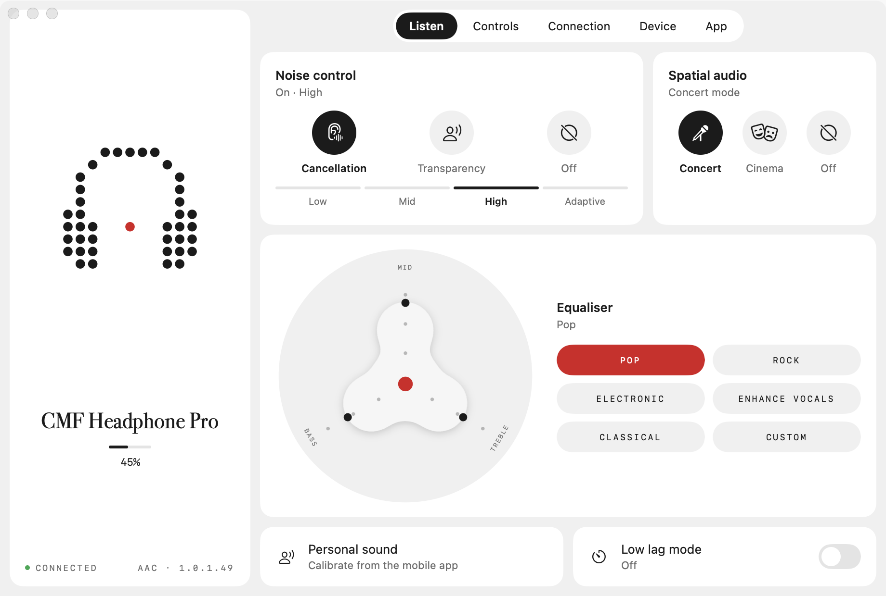
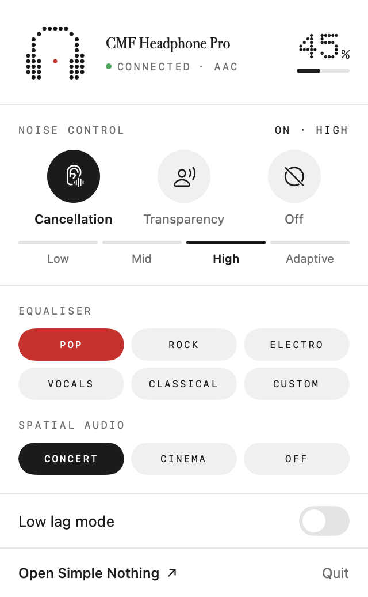
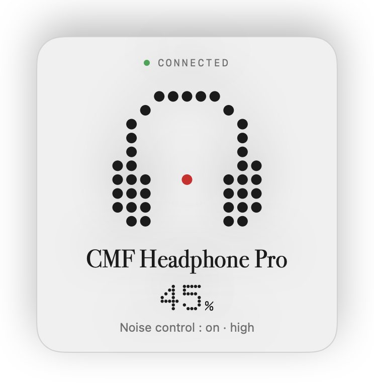

# Simple Nothing pour macOS (non officiel)

[English](README.md) · Français

Une application macOS pour régler les casques et écouteurs Nothing et CMF, que l'app officielle ne couvre que sur téléphone. Ce projet n'est ni affilié à Nothing Technology, ni soutenu par elle.



| Dans la barre des menus | À la connexion |
|---|---|
|  |  |

## Installation

Il faut macOS 14 ou plus récent et les outils en ligne de commande d'Apple (`xcode-select --install` s'ils manquent ; Xcode n'est pas nécessaire). Depuis le dossier du dépôt :

```sh
tools/install.sh
```

Le script télécharge les photos des appareils (environ 20 Mo, voir plus bas), compile l'app (environ une minute la première fois), la place dans Applications et l'ouvre. Il reste deux gestes : cliquer sur « Autoriser » quand macOS demande l'accès Bluetooth, et jumeler le casque ou les écouteurs au Mac dans Réglages Système › Bluetooth si ce n'est pas déjà fait.

Vous passez par un assistant de programmation ? Donnez-lui le dépôt et demandez-lui de l'installer : [AGENTS.md](AGENTS.md) lui dit quoi faire.

## Où en est le projet

- **Maquettes interactives** : faites. Deux versions, jour et nuit, tout l'état y est simulé.
- **Protocole** : la lecture fonctionne sur un CMF Headphone Pro (batterie, firmware, réduction du bruit, égaliseur, audio spatial, commandes, double connexion, codec). Voir [docs/protocole.md](docs/protocole.md). Les réglages aussi : mode de bruit, égaliseur (préréglages et courbe personnalisée), audio spatial, faible latence et commandes ont été écrits, relus et remis en place sur l'appareil.
- **Application** : elle détecte l'appareil relié au Mac, affiche son état réel dans la fenêtre et dans la barre des menus, et envoie les réglages. Une carte s'affiche quand l'appareil se connecte, une alerte prévient quand sa batterie est faible, et un raccourci clavier (⌃⌥A, modifiable) change de mode de bruit depuis n'importe quelle app. Elle fait sonner l'appareil pour le retrouver, relie ou détache les autres appareils de la double connexion, et ne propose que ce que chaque modèle possède (renfort des basses, détection de port, modes d'audio spatial, batterie gauche / droite / boîtier). Seul le CMF Headphone Pro a été vérifié.

## Arborescence

```
Sources/
  NothingKit/    le protocole : trames, commandes, état de l'appareil (sans dépendance, testé)
  SimpleNothing/ l'application SwiftUI : liaison Bluetooth, fenêtre, barre des menus
    Traductions/ l'anglais et l'espagnol (les textes de l'app sont écrits en français)
Tests/           tests de NothingKit, à partir d'octets relevés sur un vrai casque
maquette/        maquettes HTML/CSS/JS, sans dépendance ni étape de construction
  index.html     V1 : transposition directe de l'app mobile (tuiles et sous-pages)
  v2.html        V2 : disposition pensée pour macOS (onglets, menus déroulants, barre des menus)
  shared.js      icônes, données et briques communes aux deux
  planche.html   planche de contrôle des visuels produit
tools/
  build-app.sh         compile l'application et l'emballe en .app
  app.sh               la construit et la lance depuis le projet
  install.sh           la construit et l'installe dans /Applications
  fetch-images.sh      va chercher les photos des appareils, qui ne sont pas dans le dépôt
  release.sh           fabrique l'archive à diffuser, sans image ni police de Nothing
  make-icon.swift      dessine l'icône de l'application
  build-assets.swift   fabrique les visuels produit à partir de vos propres sources
  probe.swift          sonde Bluetooth en lecture seule
  probe.sh             compile et lance la sonde
docs/protocole.md      ce qui est vérifié du protocole
```

## Travailler sur l'app

```sh
tools/app.sh
```

Ce script lance l'app depuis le dossier du projet, sans toucher à la copie installée. L'app vit dans la barre des menus : fermer la fenêtre ne la quitte pas, et elle ne garde une icône dans le Dock que tant que la fenêtre est ouverte. Avec « Ouvrir au démarrage du Mac » (onglet Appareil), elle est là dès l'ouverture de session et annonce l'appareil quand il se connecte. Ce réglage demande que l'app soit dans `/Applications`.

macOS demande l'autorisation Bluetooth au premier lancement. Sans appareil sous la main, `tools/app.sh --demo` montre l'app avec un état factice. Les tests se lancent avec `swift test`.

L'app existe en français, anglais et espagnol. Elle suit la langue du système (anglais pour les langues qu'elle ne connaît pas) et l'onglet Appareil permet d'en choisir une autre.

Chaque réglage envoyé est suivi d'une relecture : l'écran montre ce que l'appareil a réellement retenu.

### Confirmer les réglages sur un appareil

```sh
tools/app.sh --verify rapport.txt
```

L'app modifie tour à tour le mode de bruit, l'égaliseur, l'audio spatial, la faible latence, une commande et la courbe personnalisée, relit la réponse de l'appareil, remet chaque valeur d'origine, puis écrit le résultat dans `rapport.txt` (ignoré par git : il contient les trames brutes). C'est le moyen de savoir ce qui marche sur un modèle qui n'a pas encore été vérifié.

### Diffuser l'app

```sh
tools/release.sh
```

produit `.build/SimpleNothing-<version>.zip` : l'app seule, sans photo ni police de Nothing (elle dessine alors l'appareil elle-même), prête à joindre à une version GitHub. L'utilisateur la dézippe, la glisse dans Applications et la lance. L'archive n'étant ni signée par un compte développeur Apple ni notarisée, macOS refuse le premier lancement : il faut alors ouvrir Réglages Système › Confidentialité et sécurité et cliquer sur « Ouvrir quand même ».

## Sécurité

- L'app ne fait aucune connexion réseau : ni statistiques, ni mise à jour automatique, ni compte. Elle n'a aucune dépendance tierce. Seul le script d'installation va sur le réseau, pour les photos des appareils, prises à une révision figée du dépôt d'Ear (web).
- Elle ne demande qu'une autorisation, le Bluetooth, et ne parle qu'aux appareils déjà jumelés au Mac qui déclarent le service Nothing.
- Ce que l'appareil envoie est traité comme non fiable : longueurs vérifiées, trames trop longues ou incohérentes écartées.
- Les constructions locales sont signées sans certificat, avec une identité fixée sur l'identifiant de l'app pour que macOS garde l'accord Bluetooth d'une compilation à l'autre. Une app locale qui usurperait cet identifiant hériterait de cet accord : acceptable sur sa propre machine, à remplacer par une vraie signature pour une diffusion large.
- L'app n'est pas en bac à sable.
- Elle tient un court journal des connexions dans `~/Library/Logs/Simple Nothing.log` (délais, échecs, blocages), sans numéro de série ni adresse. Il ne quitte jamais le Mac ; joignez-le à un rapport de bug si une connexion se passe mal.

## Voir les maquettes

```sh
python3 -m http.server 4173 --directory maquette
```

Puis ouvrir `http://localhost:4173/v2.html`. La barre noire en bas de page pilote la maquette (thème, appareil connecté ou non, arrivée d'un nouvel appareil) et permet de passer d'une version à l'autre.

## Ce qui reste hors du dépôt

Les photos des appareils et les polices appartiennent à Nothing (et à Lineto pour Lettera Mono) : elles ne sont pas dans le dépôt.

- **Photos** : `tools/install.sh` les télécharge une fois depuis le dépôt public d'[Ear (web)](https://github.com/radiance-project/ear-web) et les range dans `originaux/ear-web/`, que git ignore. `NOTHING_SANS_IMAGES=1 tools/install.sh` s'en passe.
- **Sans photos**, comme sur les captures ci-dessus, l'app dessine elle-même l'appareil et les grands chiffres en matrice de points.
- **Polices** : l'app prend ses caractères dans les polices du système (Bodoni 72 pour les noms, la police à chasse fixe du système pour les étiquettes).

Si vous avez d'autres fichiers à vous, `originaux/` les accueille :

| Dossier | Contenu | Utilisé par |
|---|---|---|
| `originaux/ear-web/` | `<modèle>_<couleur>.webp`, par exemple `b175_black.webp` : l'appareil vu de face | app |
| `originaux/polices/` | `NType82-Regular.otf`, `LetteraMono-LL.otf`, `NDot-55.otf` | maquettes et app |
| `originaux/icone.png` | une icône carrée de votre choix | app, à la place de l'icône fournie |
| `originaux/captures/` | captures d'écran de l'app mobile (1280 × 2772, nommées `26725.jpg`… comme attendu par le script) | maquettes |
| `originaux/site/` | images enregistrées depuis le site Nothing | maquettes ; vues de trois quarts du CMF Headphone Pro dans l'app |

Les visuels des maquettes se fabriquent avec :

```sh
mkdir -p .build && swiftc -O tools/build-assets.swift -o .build/build-assets && .build/build-assets
```

Le script recadre, détoure et range le tout dans `maquette/assets/`.

## Sonder un appareil

Appareil allumé et connecté au Mac en Bluetooth :

```sh
tools/probe.sh
```

La sonde n'envoie que des lectures. macOS demande l'autorisation Bluetooth au premier lancement.

## Suite prévue

1. Confirmer les écritures restantes (double connexion et sa liste d'appareils, sonnerie, et sur les autres modèles renfort des basses et détection de port).
2. Compléter l'application : appairage d'un appareil jamais relié au Mac, délai d'extinction automatique, commandes des écouteurs.
3. Distribution : une archive téléchargeable, signée et notarisée, pour installer sans compiler.
4. Étendre aux autres modèles, dont les capacités diffèrent.

## Projets voisins

- [nothing-bar](https://github.com/bestK1ngArthur/nothing-bar) : une app de barre des menus pour macOS existe déjà (GPL-3.0).
- [Ear (web)](https://github.com/radiance-project/ear-web) et [BudsLink](https://github.com/maniacx/BudsLink) : sources de la documentation du protocole.

## Licence

Le code est sous [GPL-3.0](LICENSE) : vous pouvez l'utiliser, le modifier et le redistribuer, à condition de publier vos modifications sous la même licence.

Nothing, CMF et les noms de produits sont des marques de Nothing Technology Limited. Ce projet n'est ni affilié à Nothing Technology, ni soutenu par elle.
