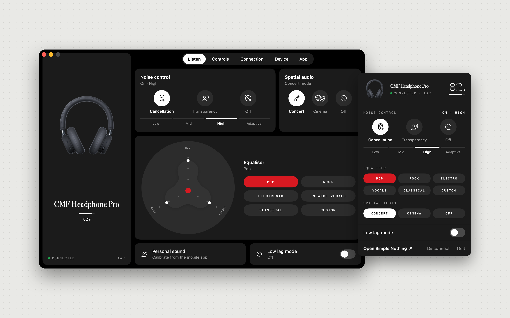
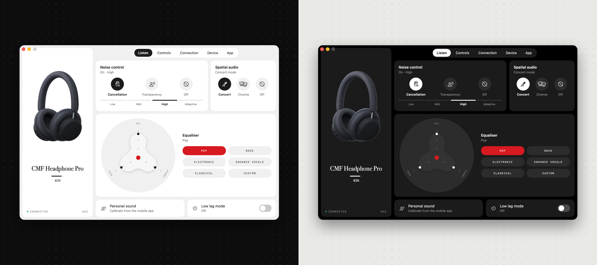
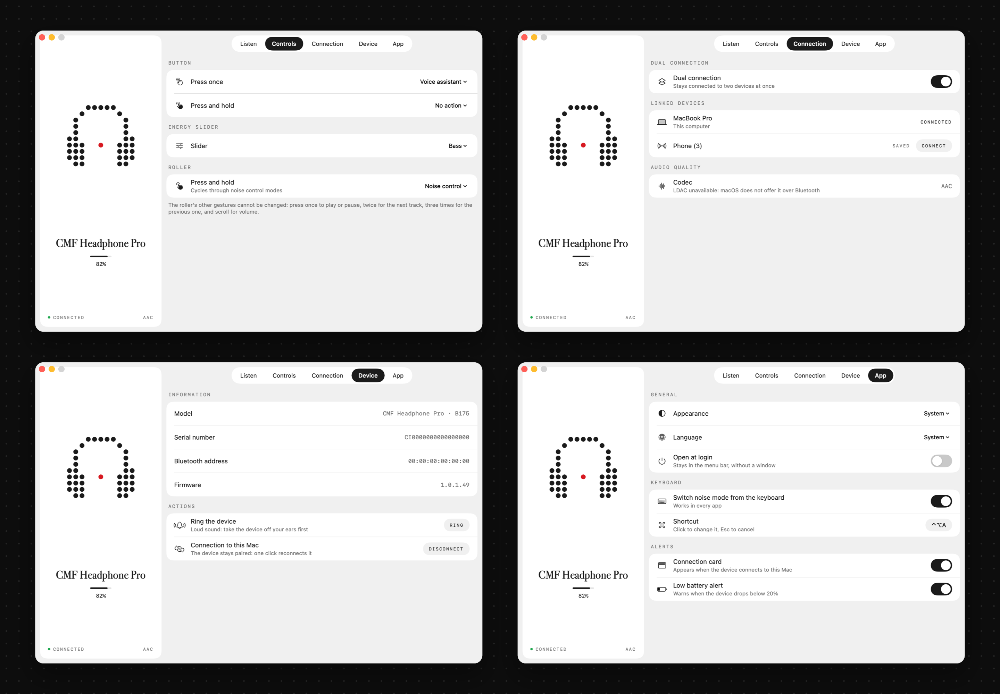
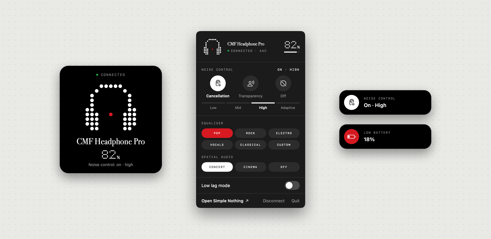

# Simple Nothing for macOS (unofficial)

English · [Français](README.fr.md)

A macOS app to control Nothing and CMF headphones and earbuds, which the official app only supports on phones. This project is not affiliated with or endorsed by Nothing Technology.



Light or dark, your choice:



Controls, dual connection, device and app settings:



Outside the window: a card when the device connects, the menu bar panel, and notices for the keyboard shortcut and a low battery.



These pictures are made from the app itself by `tools/make-screens.sh`, with the public build: the device is drawn in dots. Installed with `tools/install.sh`, the app shows the real product pictures.

## Install

You need macOS 14 or later and Apple's Command Line Tools (`xcode-select --install` if they are missing; full Xcode is not required). In Terminal:

```sh
git clone https://github.com/Kaizeur-io/simple-nothing-macos.git
cd simple-nothing-macos
tools/install.sh
```

The script downloads the device pictures (about 20 MB, see below), builds the app (about a minute the first time), puts it in Applications and opens it. Two things are left to you: click "Allow" when macOS asks for Bluetooth access, and pair your headphones with the Mac in System Settings › Bluetooth if that is not done yet.

Using a coding assistant? Hand it the repository and ask it to install: [AGENTS.md](AGENTS.md) tells it what to do.

## What it does

- Finds the Nothing or CMF device connected to the Mac and shows its real state: battery, noise control, equaliser, spatial audio, low lag mode, button mapping, dual connection, codec, firmware.
- Changes those settings. Every change is read back from the device, so the screen shows what the device actually kept.
- Lives in the menu bar: a panel with the essentials, a card when the device connects, a low-battery notice, and a keyboard shortcut (⌃⌥A unless you change it) to switch noise mode from any app.
- Connects or disconnects the device from the Mac without opening Bluetooth settings.
- Rings the device to find it, and connects or disconnects the other devices of the dual connection.
- Only offers what each model has: bass enhancement, wear detection, spatial audio modes and left / right / case battery appear where the model supports them.
- Available in English, French and Spanish, in light or dark appearance.

## Supported devices

| | Models |
|---|---|
| **Verified on a real device** | CMF Headphone Pro |
| **Recognised, not tested yet** | Nothing Headphone (1), Headphone (1) Pro, Headphone (a), Ear (1), Ear (2), Ear (stick), Ear, Ear (a), Ear (open), Ear (3), Ear (3a) · CMF Buds, Buds Pro, Buds Pro 2, Buds 2, Buds 2 Plus, Buds 2a, Buds Neo, Clip Pro |

"Recognised" means the app identifies the model, shows its picture and offers the settings the official app has for it, using the same protocol. None of that has been tried on real hardware, so some settings may not work. If you own one of these, `tools/app.sh --verify report.txt` (below) tells you in a minute what works, and an issue with that report is the most useful contribution you can make. See [docs/protocol.md](docs/protocol.md) for what has been confirmed.

## Repository layout

```
Sources/
  NothingKit/    the protocol: frames, commands, device state (no dependency, tested)
  SimpleNothing/ the SwiftUI app: Bluetooth link, window, menu bar
    Traductions/ English and Spanish (the app's strings are written in French)
Tests/           NothingKit tests, built from bytes captured on a real headset
maquette/        HTML/CSS/JS mockups the app was designed from
tools/
  install.sh           builds the app and installs it in /Applications
  fetch-images.sh      downloads the device pictures, which are not in the repository
  build-app.sh         builds the app and packages it as a .app
  app.sh               builds and runs it from the project folder
  release.sh           makes the archive to distribute, without any Nothing picture or font
  make-screens.sh      makes the pictures of this page from the app in demo mode
  check-translations.sh  checks that every interface text has its English and Spanish translation
  make-icon.swift      draws the app icon
  build-assets.swift   builds the mockups' pictures from your own sources
  probe.swift, probe.sh   read-only Bluetooth probe
docs/protocol.md       what has been verified of the protocol (protocole.md is the French original)
```

Code comments, commit messages and the app's source strings are in French.

## Working on the app

```sh
tools/app.sh
```

runs the app from the project folder without touching the installed copy. The app lives in the menu bar: closing the window does not quit it, and it only keeps a Dock icon while the window is open. With "Open at login" (App tab) it is there from the start of the session and announces the device when it connects; that setting needs the app to be in `/Applications`.

Without a device at hand, `tools/app.sh --demo` shows the app with made-up data. `swift test` runs the tests.

### Confirming settings on a device

```sh
tools/app.sh --verify report.txt
```

The app changes, one after the other, the noise mode, the equaliser, spatial audio, low lag mode, one button mapping and the custom curve; reads the device's answer; puts every value back; then writes the result to `report.txt`. This is how to find out what works on a model that has not been verified yet.

### Distributing the app

```sh
tools/release.sh
```

produces `.build/SimpleNothing-<version>.zip`: the app alone, with no Nothing picture or font (it then draws the device itself), ready to attach to a GitHub release. People unzip it, drag it to Applications and open it. The archive is neither signed with an Apple developer account nor notarised, so macOS refuses the first launch: open System Settings › Privacy & Security and click "Open Anyway".

## Security

- The app makes no network connection: no analytics, no automatic update, no account. It has no third-party dependency. Only the install script goes online, for the device pictures, taken from a pinned revision of the Ear (web) repository.
- It asks for one permission, Bluetooth, and only talks to devices already paired with the Mac that advertise the Nothing service.
- What the device sends is treated as untrusted: lengths are checked, oversized or inconsistent frames are dropped.
- Local builds are signed without a certificate, with an identity pinned to the app's identifier so that macOS keeps the Bluetooth permission from one build to the next. A local app impersonating that identifier would inherit the permission: acceptable on your own machine, to be replaced by a real signature for wide distribution.
- The app is not sandboxed.
- It keeps a short connection log in `~/Library/Logs/Simple Nothing.log` (timings, failures, freezes), with no serial number or address in it. It never leaves the Mac; attach it to a bug report if a connection misbehaves.

## What stays out of the repository

Device pictures and fonts belong to Nothing (and to Lineto for Lettera Mono): they are not in the repository.

- **Pictures**: `tools/install.sh` downloads them once from the public [Ear (web)](https://github.com/radiance-project/ear-web) repository into `originaux/ear-web/`, which git ignores. `NOTHING_SANS_IMAGES=1 tools/install.sh` skips that.
- **Without pictures**, as in the screenshots above, the app draws the device and the large numbers itself, as dot matrices.
- **Fonts**: the app uses system fonts (Bodoni 72 for names, the system monospaced font for labels).

If you have other files of your own, `originaux/` takes them:

| Folder | Content | Used by |
|---|---|---|
| `originaux/ear-web/` | `<model>_<colour>.webp`, for example `b175_black.webp`: the device seen from the front | app |
| `originaux/polices/` | `NType82-Regular.otf`, `LetteraMono-LL.otf`, `NDot-55.otf` | mockups and app |
| `originaux/icone.png` | a square icon of your choice | app, instead of the provided icon |

## Roadmap

1. Confirm the other models on real hardware, starting with what the CMF Headphone Pro cannot show: bass enhancement, wear detection, earbud gestures, left / right ring.
2. Complete the app: pairing a device that has never been connected to the Mac, automatic power-off delay (its command is not documented anywhere yet).
3. Distribution: a downloadable archive, signed and notarised, to install without building.

## Related projects

- [nothing-bar](https://github.com/bestK1ngArthur/nothing-bar): another menu bar app for macOS (GPL-3.0).
- [Ear (web)](https://github.com/radiance-project/ear-web) and [BudsLink](https://github.com/maniacx/BudsLink): where the protocol documentation comes from. No code from these projects is included here.

## Licence

The code is released under the [GPL-3.0](LICENSE): you may use, modify and redistribute it, provided you publish your changes under the same licence.

Nothing, CMF and product names are trademarks of Nothing Technology Limited. This project is not affiliated with or endorsed by Nothing Technology.
